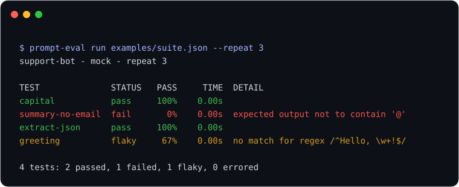

# prompt-eval-lite

[](https://github.com/YusufBeratZengin/prompt-eval-lite/actions/workflows/ci.yml)
[](https://pypi.org/project/prompt-eval-lite/)
[](LICENSE)
[](pyproject.toml)
[](pyproject.toml)

[English](README.md) | Türkçe

Prompt'lar için regresyon testi: prompt'larınızı ve beklentilerinizi bir JSON ya da YAML dosyasına yazın, OpenAI uyumlu uç noktalara, Ollama'ya ya da deterministik bir mock sağlayıcıya karşı çalıştırın; terminal tablosu, CI için JUnit XML, JSON raporu, önceki çalıştırmayla karşılaştırma ve kararsızlık ölçümü alın.

Zorunlu bağımlılığı yoktur (yalnızca standart kütüphane, HTTP için `urllib`), dahili mock sağlayıcıyla internetsiz çalışır ve API anahtarını hiçbir dosyadan okumaz.

```bash
pip install prompt-eval-lite          # YAML için "[yaml]" ekleyin
prompt-eval run examples/suite.json --repeat 3
```



## Demo

Yukarıdaki görsel, `python scripts/make-demo.py` ile aracın gerçek çıktısından üretilir. İki test geçer, `summary-no-email` bir `not_contains` kontrolünde takılır, `greeting` ise kararsızdır: mock sağlayıcı yanıtlarını sırayla döndürdüğü için üç çalıştırmanın biri "Hello, Ada!" yerine "Hi there" der.

## Kurulum

```bash
pip install prompt-eval-lite
pip install "prompt-eval-lite[yaml]"   # .yaml/.yml dosyaları için isteğe bağlı PyYAML
```

Python 3.10 veya üzeri gerekir. PyPI'da ilk sürüm yayımlanana kadar klonlanmış depodan kurun: `pip install -e .`.

## Kullanım

### Test dosyası

```json
{
  "name": "support-bot",
  "provider": {"type": "openai", "model": "gpt-4o-mini"},
  "tests": [
    {
      "name": "capital",
      "prompt": "What is the capital of {{country}}?",
      "vars": {"country": "France"},
      "expect": [{"contains": "Paris"}, {"not_contains": "Lyon"}, {"max_length": 80}]
    }
  ]
}
```

Aynı dosya YAML olarak:

```yaml
name: support-bot
provider: {type: openai, model: gpt-4o-mini}
tests:
  - name: capital
    prompt: "What is the capital of {{country}}?"
    vars: {country: France}
    expect:
      - contains: Paris
      - max_length: 80
```

Dosya düzeyindeki `vars` ve `system` varsayılandır, her test bunları ezebilir. `{{ ad }}` yer tutucuları `vars` içinden doldurulur; tanımsız bir değişken o test için hata olarak raporlanır.

### Beklentiler

| Beklenti | Şu durumda geçer |
|---|---|
| `contains: metin` | çıktı `metin`i içerir |
| `not_contains: metin` | çıktı `metin`i içermez |
| `regex: desen` | `re.search(desen, çıktı)` eşleşir |
| `equals: metin` | baştaki/sondaki boşlukları atılmış çıktı, `metin`e eşittir |
| `max_length: n` / `min_length: n` | çıktı en fazla / en az `n` karakterdir |
| `is_json: true` | çıktı JSON olarak ayrışır (Markdown kod bloğu tolere edilir) |
| `json_schema: {...}` | ayrışan JSON, şema alt kümesine uyar: `type`, `enum`, `const`, `required`, `properties`, `items`, `minimum`, `maximum`, `minLength`, `maxLength`, `minItems`, `maxItems` |

`contains`, `not_contains`, `regex` ve `equals` yanına `ignore_case: true` ekleyebilirsiniz. Uzun yazım da geçerlidir: `{type: contains, value: Paris}`.

### Sağlayıcılar

| `type` | Seçenekler | Not |
|---|---|---|
| `openai` | `model` (zorunlu), `base_url` (varsayılan `https://api.openai.com/v1`), `api_key_env` (varsayılan `OPENAI_API_KEY`), `timeout`, `temperature` | `POST {base_url}/chat/completions` çağırır; vLLM, LM Studio, llama.cpp sunucusu gibi uyumlu sunucularla çalışır. |
| `ollama` | `model` (zorunlu), `base_url` (varsayılan `http://localhost:11434`), `timeout`, `temperature` | `POST /api/generate` çağırır. |
| `mock` | `rules`, `default` | Deterministik ve çevrimdışı. Kural, `match` (alt metin) ya da `regex` ile `reply` ya da `replies` (her çağrıda sırayla döner) alır. Eşleşen kural yoksa `default`, o da yoksa `mock: <prompt>` döner. |

API anahtarları yalnızca `api_key_env` ile adı verilen ortam değişkeninden okunur; test dosyalarından asla okunmaz.

### Komut satırı

```bash
prompt-eval run SUITE [--provider mock|openai|ollama] [--model M] [--base-url URL]
                      [--repeat N] [--baseline report.json] [--fail-on any|regression]
                      [--junit out.xml] [--json out.json] [--no-color]
```

Çıkış kodları: `0` her şey yolunda, `1` bir test kaldı (ya da geriledi, bkz. `--fail-on`), `2` hatalı kullanım veya okunamayan dosya.

### Baseline ve gerileme

```bash
prompt-eval run examples/suite.json --json baseline.json     # iyi bilinen bir çalıştırmayı kaydet
prompt-eval run examples/suite.json --repeat 3 --baseline baseline.json
```

İkinci komutun gerçek çıktısı (tek çalıştırmalık bir baseline sonrası):

```text
Baseline comparison
  Regressions (1):
    - greeting: 100% -> 67%
  Unchanged: 3
```

Gerileme, geçme oranı baseline'a göre düşen testtir. Zaten kalan testler CI'nızı engellemesin istiyorsanız `--fail-on regression` kullanın.

### Kararsızlık (flaky test)

`--repeat N` her testi `N` kez çalıştırır. Her seferinde geçen test `pass`, hiç geçmeyen `fail` (tüm çalıştırmalar sağlayıcı hatasıysa `error`), bazen geçen ise geçme oranıyla birlikte `flaky` olur. JUnit çıktısında `flaky` başarısız sayılır.

### Kütüphane olarak

```python
from prompt_eval_lite import load_suite, make_provider, run_suite

suite = load_suite("examples/suite.json")
results = run_suite(suite, make_provider(suite.provider), repeat=3)
print([(r.name, r.status, r.pass_rate) for r in results])
```

## Örnekler

[`examples/`](examples/) klasörüne bakın: `suite.json` (yukarıdaki demo, mock sağlayıcı) ve `suite.yaml`.

## Nasıl çalışır

Yükleyici dosyayı doğrular ve her beklentiyi küçük bir nesneye çevirir. Çalıştırıcı her test için prompt'u oluşturur, sağlayıcıya `repeat` kez sorar ve her yanıta beklentileri uygular. Raporlayıcılar sonucu tablo, JSON ya da JUnit XML olarak yazar; `--baseline` ise geçme oranlarını test adına göre karşılaştırır.

## Sınırlar ve gizlilik

- Kontroller deterministik metin ve JSON kontrolleridir. LLM ile değerlendirme ya da anlamsal benzerlik yoktur.
- JSON Schema desteği küçük bir alt kümedir, tam bir doğrulayıcı değildir.
- İstekler sırayla ve akışsız gönderilir. Prompt'lar ve çıktılar seçtiğiniz uç noktaya gider ve JSON raporlarına olduğu gibi yazılır; üçüncü taraf servislere gönderdiğiniz prompt'lara gizli bilgi ya da kişisel veri koymayın.
- Bu projenin testleri mock sağlayıcı ve yerel (loopback) sahte sunucu kullanır; gerçek ağ çağrısı yapmaz.

## Geliştirme

```bash
git clone https://github.com/YusufBeratZengin/prompt-eval-lite.git
cd prompt-eval-lite
pip install -e ".[dev]"
ruff check . && ruff format --check . && mypy && pytest
python scripts/make-demo.py     # docs/demo.svg dosyasını yeniden üret
```

## Katkı

[CONTRIBUTING.md](CONTRIBUTING.md) dosyasına bakın. Katılarak [Davranış Kuralları](CODE_OF_CONDUCT.md)nı kabul etmiş olursunuz. Güvenlik sorunları için [SECURITY.md](SECURITY.md).

## Lisans

[MIT](LICENSE)
